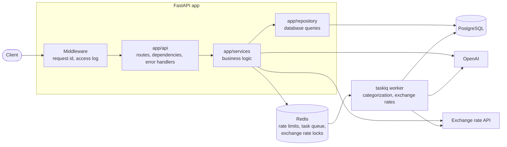

# Smart Wallet

A personal finance API built with FastAPI. Users keep wallets in 15 currencies (UAH, USD, EUR, GBP, JPY, CHF, CNY, CAD, AUD, HKD, SGD, SEK, NOK, KRW, NZD), record income and expenses, transfer money between their wallets with currency conversion, and browse their operation history.

Operations can be entered as plain text: "coffee 85 from Monobank, taxi 200 cash yesterday" becomes ready drafts that the user checks and confirms. New income and expense operations are categorized automatically by an OpenAI model in a background worker. Text can be in English or Ukrainian.

Analytics shows income and expenses of a month, quarter, year or any range by category, compares them with the previous period, and draws them day by day, week by week or month by month. Reports can be in any currency: every operation is converted at the exchange rate of its own day.

Next on the roadmap: AI tips based on these numbers, semantic search with pgvector, and an assistant that answers questions about your finances.

## Features

| Endpoint | Description | Auth |
|---|---|---|
| `POST /api/v1/users` | Register, with an IANA time zone such as `Europe/Kyiv` | — |
| `GET /api/v1/users/me` | Current user | ✓ |
| `PATCH /api/v1/users/me` | Change the time zone | ✓ |
| `POST /api/v1/auth/login` | Log in: sets the token cookies, attempts are rate limited | — |
| `POST /api/v1/auth/refresh` | Get a new token pair with the refresh token | refresh cookie |
| `POST /api/v1/auth/logout` | Revoke the refresh token and delete the cookies | — |
| `POST /api/v1/wallets` | Create a wallet | ✓ |
| `GET /api/v1/wallets` | List own wallets | ✓ |
| `GET /api/v1/balance` | Total balance of all wallets at the current rate, in UAH or `?currency=` | ✓ |
| `POST /api/v1/operations/income` | Add income, optionally with a past date | ✓ |
| `POST /api/v1/operations/expense` | Add an expense, optionally with a past date | ✓ |
| `POST /api/v1/operations/transfers` | Transfer between own wallets, converted at the current rate | ✓ |
| `POST /api/v1/operations/parse` | Turn plain text into operation drafts. Saves nothing, rate limited per user | ✓ |
| `GET /api/v1/operations` | Operation history: pages, sorting, filters by wallet and date | ✓ |
| `GET /api/v1/analytics/summary` | Totals of a period by category and subcategory, compared with the previous period | ✓ |
| `GET /api/v1/analytics/categories` | Expense or income categories of a period and of the previous one, as Chart.js data | ✓ |
| `GET /api/v1/analytics/timeline` | Income and expenses of a period by day, week or month, as Chart.js data | ✓ |
| `GET /health/live` | The process is running | — |
| `GET /health/ready` | The database answers | — |

Interactive documentation: <http://localhost:8000/docs> once the app is running.

## Tech stack

| Area | Tools |
|---|---|
| API | Python 3.12, FastAPI, Pydantic, Uvicorn |
| Database | PostgreSQL 17, SQLAlchemy 2.1 (async), psycopg 3, Alembic |
| Cache and rate limiting | Redis 8, redis-py |
| Auth | JWT access tokens (PyJWT), rotating refresh tokens, Argon2 password hashes (pwdlib), HttpOnly cookies |
| AI | OpenAI Python SDK (Responses API, structured outputs, function calling) |
| Background tasks | taskiq with a Redis Streams broker |
| External APIs | aiohttp |
| Pagination | fastapi-pagination |
| Quality | pytest, Ruff, mypy (strict) |
| Tooling | uv, Docker Compose, GitHub Actions |

## Architecture



- **Layers.** Routes only handle HTTP. Services hold the business rules and know nothing about HTTP. Repositories only run queries. Models (`app/models`) describe tables, schemas (`app/schemas`) describe request and response bodies.
- **Errors.** Services raise their own exceptions. A group of errors maps to one HTTP status, and every error response has the same shape: `{"error": {"code": "...", "message": "..."}}`.
- **Money.** Balances are `Decimal` and `NUMERIC(18, 2)`. Wallet rows are locked with `SELECT ... FOR UPDATE` in a fixed order, so concurrent operations never lose an update and transfers cannot deadlock. The exchange rate is fetched before the locks are taken.
- **Rate limiting.** Login attempts are counted in Redis by IP and by IP plus login, in one atomic Lua script. If Redis is down, login still works and the error is logged.
- **Categorization.** After an income or expense is saved, the API puts a task into a Redis stream and answers at once. A separate worker asks the model for a category with structured outputs: the answer is always one value of a fixed enum such as `food.groceries`, so the model cannot invent a category. Until the worker is done, the operation has `category: null`. If Redis or OpenAI is unavailable, the operation is still saved, it only stays uncategorized.
- **Text input.** The model gets three functions (add an expense, add an income, create a transfer) and calls one for every operation in the text. The schema of the functions is built for each request and lists only the user's own wallets, so the model cannot pick another one, and the code checks it again. The answer is a list of drafts: nothing is saved until the client sends a draft to the usual operation endpoints, which own all the money checks. Amounts in another currency are converted at the current rate, and the draft keeps what the user wrote. Dates like "yesterday" are resolved in the user's time zone.
- **Analytics.** A period is a range of days in the user's time zone: the current month by default, a month, quarter or year that holds a date, or a range up to ten years. SQL sums the operations by local day, currency and category and converts each sum at the rate of its day, then the service rounds the smallest parts first, so they always add up to the totals. Transfers between own wallets are not counted. A period still going on is compared with the same days of the previous one.
- **Exchange rates by day.** Past rates never change, so they are stored in Postgres and never cleaned up: one API request per day fills every currency. Concurrent reports that need the same missing day share one load: in-process single flight, plus a Redis lock (`SET NX EX`, released by a Lua script) between processes, where a waiting process checks the database less and less often. If Redis is down, rates are loaded without the lock. New operations queue a task that loads the rates of their day ahead of the first report.
- **Observability.** Every response has an `X-Request-ID` header, and every log line of that request carries the same id. Logs are plain text locally and JSON on servers.

```text
app/
├── main.py          app setup: lifespan, middleware, routers
├── worker.py        taskiq broker and background tasks
├── run_worker.py    starts the worker
├── ai/              AI features, one package per feature: categorization/, parsing/ (text to drafts)
├── api/             routes (v1/), dependencies, error handlers, middleware, health checks
├── services/        business logic
├── repository/      database queries
├── models/          SQLAlchemy models
├── schemas/         Pydantic schemas
└── core/            settings, exceptions, security, cookies, logging
alembic/             database migrations
evals/               examples and scripts that measure the quality of each AI feature
tests/               API, database, service and config tests
```

## Getting started

Requirements: [uv](https://docs.astral.sh/uv/) and Docker.

```bash
cp .env.example .env
# Set POSTGRES_PASSWORD and JWT_SECRET_KEY in .env, for example with:
# uv run python -c "import secrets; print(secrets.token_hex(32))"
# Set OPENAI_API_KEY to a key from https://platform.openai.com/api-keys

uv sync
docker compose up -d --wait
uv run alembic upgrade head
uv run uvicorn app.main:app --reload
```

In a second terminal, start the worker that categorizes operations and loads exchange rates ahead of reports:

```bash
uv run python -m app.run_worker
```

Open <http://localhost:8000/docs>.

Docker Compose starts four containers: `db` and `redis` for the app, and `db-test` and `redis-test` for the tests. All ports are bound to `127.0.0.1` only.

## Configuration

Settings are read from environment variables or from `.env`. All of them are listed with comments in [`.env.example`](.env.example).

| Variable | Required | Description |
|---|---|---|
| `DATABASE_URL` | ✓ | PostgreSQL connection string |
| `REDIS_URL` | ✓ | Redis connection string |
| `JWT_SECRET_KEY` | ✓ | Secret for signing access tokens, at least 32 characters |
| `OPENAI_API_KEY` | ✓ | OpenAI API key for categorization and text input |
| `OPENAI_MODEL` | | `gpt-6-luna` by default |
| `POSTGRES_USER`, `POSTGRES_PASSWORD`, `POSTGRES_DB` | ✓ | Used by Docker Compose to create the database |
| `PARSE_RATE_LIMIT_PER_USER`, `PARSE_RATE_LIMIT_WINDOW_SECONDS` | | Text input requests per user: 10 per 60 seconds by default |
| `EXCHANGE_API_HISTORY_URL`, `EXCHANGE_API_HISTORY_START` | | Rates of past days for analytics, and the first day the API has them |
| `ANALYTICS_MAX_RANGE_DAYS` | | Longest report range: ten years by default |
| `LOG_LEVEL`, `LOG_FORMAT` | | `INFO` and `text` by default. Use `json` on servers |

The app does not start if a required setting is missing or invalid.

## Development

```bash
uv run pytest              # tests, need the db-test and redis-test containers
uv run ruff check .        # lint
uv run ruff format .       # format
uv run mypy                # type check
```

Tests run against real PostgreSQL and Redis, not mocks: row locks, constraints and numeric precision are behaviour of the database itself. The schema is built by the Alembic migrations, so the tests also check the migrations. OpenAI is never called from tests: they use a fake client.

The quality of the AI features is measured separately, against the real model. Each script sends about 50 short requests with the key from `.env` and prints the accuracy, the mistakes and how many tokens were used:

```bash
uv run python -m evals.run_categorization
uv run python -m evals.run_parsing
```

Database schema changes:

```bash
uv run alembic revision --autogenerate -m "describe the change"   # then read the generated file
uv run alembic upgrade head
```

## CI

GitHub Actions ([`.github/workflows/ci.yml`](.github/workflows/ci.yml)) runs on every pull request and on every push to `main`. It has two jobs:

- `lint`: `ruff check`, `ruff format --check`, `mypy`;
- `tests`: `pytest -W error` against PostgreSQL and Redis service containers.

## Versioning

The project follows [Semantic Versioning](https://semver.org/). The version is kept only in [`pyproject.toml`](pyproject.toml) and is shown in the API docs. It is bumped with `uv version --bump patch|minor|major`, and every release is tagged as `vX.Y.Z`.

## License

[MIT](LICENSE)
