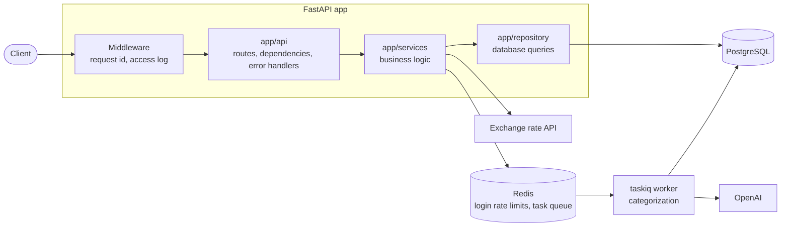

# Smart Wallet

A personal finance API built with FastAPI. Users keep wallets in different currencies, record income and expenses, transfer money between their wallets with currency conversion, and browse their operation history.

New income and expense operations are categorized automatically by an OpenAI model in a background worker. Descriptions can be in English or Ukrainian. Next on the roadmap: semantic search with pgvector, and an assistant that answers questions about your finances.

## Features

| Endpoint | Description | Auth |
|---|---|---|
| `POST /api/v1/users` | Register | — |
| `GET /api/v1/users/me` | Current user | ✓ |
| `POST /api/v1/auth/login` | Log in: sets the token cookies, attempts are rate limited | — |
| `POST /api/v1/auth/refresh` | Get a new token pair with the refresh token | refresh cookie |
| `POST /api/v1/auth/logout` | Revoke the refresh token and delete the cookies | — |
| `POST /api/v1/wallets` | Create a wallet | ✓ |
| `GET /api/v1/wallets` | List own wallets | ✓ |
| `GET /api/v1/balance` | Total balance of all wallets in UAH | ✓ |
| `POST /api/v1/operations/income` | Add income | ✓ |
| `POST /api/v1/operations/expense` | Add an expense | ✓ |
| `POST /api/v1/operations/transfers` | Transfer between own wallets, converted at the current rate | ✓ |
| `GET /api/v1/operations` | Operation history: pages, sorting, filters by wallet and date | ✓ |
| `GET /health/live` | The process is running | — |
| `GET /health/ready` | The database answers | — |

Interactive documentation: <http://localhost:8000/docs> once the app is running.

## Tech stack

| Area | Tools |
|---|---|
| API | Python 3.12, FastAPI, Pydantic, Uvicorn |
| Database | PostgreSQL 17, SQLAlchemy 2.1 (async), psycopg 3, Alembic |
| Cache and rate limiting | Redis 8, redis-py |
| Auth | JWT access tokens (PyJWT), rotating refresh tokens, Argon2 password hashes (pwdlib), HttpOnly cookies |
| AI | OpenAI Python SDK (Responses API, structured outputs) |
| Background tasks | taskiq with a Redis Streams broker |
| External APIs | aiohttp |
| Pagination | fastapi-pagination |
| Quality | pytest, Ruff, mypy (strict) |
| Tooling | uv, Docker Compose, GitHub Actions |

## Architecture



- **Layers.** Routes only handle HTTP. Services hold the business rules and know nothing about HTTP. Repositories only run queries. Models (`app/models`) describe tables, schemas (`app/schemas`) describe request and response bodies.
- **Errors.** Services raise their own exceptions. A group of errors maps to one HTTP status, and every error response has the same shape: `{"error": {"code": "...", "message": "..."}}`.
- **Money.** Balances are `Decimal` and `NUMERIC(18, 2)`. Wallet rows are locked with `SELECT ... FOR UPDATE` in a fixed order, so concurrent operations never lose an update and transfers cannot deadlock. The exchange rate is fetched before the locks are taken.
- **Rate limiting.** Login attempts are counted in Redis by IP and by IP plus login, in one atomic Lua script. If Redis is down, login still works and the error is logged.
- **Categorization.** After an income or expense is saved, the API puts a task into a Redis stream and answers at once. A separate worker asks the model for a category with structured outputs: the answer is always one value of a fixed enum such as `food.groceries`, so the model cannot invent a category. Until the worker is done, the operation has `category: null`. If Redis or OpenAI is unavailable, the operation is still saved, it only stays uncategorized.
- **Observability.** Every response has an `X-Request-ID` header, and every log line of that request carries the same id. Logs are plain text locally and JSON on servers.

```text
app/
├── main.py          app setup: lifespan, middleware, routers
├── worker.py        taskiq broker and background tasks
├── run_worker.py    starts the worker
├── ai/              AI features, one package per feature (categorization/: categories, prompt, service)
├── api/             routes (v1/), dependencies, error handlers, middleware, health checks
├── services/        business logic
├── repository/      database queries
├── models/          SQLAlchemy models
├── schemas/         Pydantic schemas
└── core/            settings, exceptions, security, cookies, logging
alembic/             database migrations
evals/               categorization examples and a script that measures accuracy
tests/               API, database, service and config tests
```

## Getting started

Requirements: [uv](https://docs.astral.sh/uv/) and Docker.

```bash
cp .env.example .env
# Set POSTGRES_PASSWORD and JWT_SECRET_KEY in .env, for example with:
# uv run python -c "import secrets; print(secrets.token_hex(32))"
# Set OPENAI_API_KEY to a key from https://platform.openai.com/api-keys

uv sync
docker compose up -d --wait
uv run alembic upgrade head
uv run uvicorn app.main:app --reload
```

In a second terminal, start the worker that categorizes operations:

```bash
uv run python -m app.run_worker
```

Open <http://localhost:8000/docs>.

Docker Compose starts four containers: `db` and `redis` for the app, and `db-test` and `redis-test` for the tests. All ports are bound to `127.0.0.1` only.

## Configuration

Settings are read from environment variables or from `.env`. All of them are listed with comments in [`.env.example`](.env.example).

| Variable | Required | Description |
|---|---|---|
| `DATABASE_URL` | ✓ | PostgreSQL connection string |
| `REDIS_URL` | ✓ | Redis connection string |
| `JWT_SECRET_KEY` | ✓ | Secret for signing access tokens, at least 32 characters |
| `OPENAI_API_KEY` | ✓ | OpenAI API key for categorization |
| `OPENAI_MODEL` | | `gpt-6-luna` by default |
| `POSTGRES_USER`, `POSTGRES_PASSWORD`, `POSTGRES_DB` | ✓ | Used by Docker Compose to create the database |
| `LOG_LEVEL`, `LOG_FORMAT` | | `INFO` and `text` by default. Use `json` on servers |

The app does not start if a required setting is missing or invalid.

## Development

```bash
uv run pytest              # tests, need the db-test and redis-test containers
uv run ruff check .        # lint
uv run ruff format .       # format
uv run mypy                # type check
```

Tests run against real PostgreSQL and Redis, not mocks: row locks, constraints and numeric precision are behaviour of the database itself. The schema is built by the Alembic migrations, so the tests also check the migrations. OpenAI is never called from tests: they use a fake client.

Categorization quality is measured separately, against the real model. The script sends about 50 short requests with the key from `.env` and prints how many tokens they used:

```bash
uv run python -m evals.run_categorization
```

Database schema changes:

```bash
uv run alembic revision --autogenerate -m "describe the change"   # then read the generated file
uv run alembic upgrade head
```

## CI

GitHub Actions ([`.github/workflows/ci.yml`](.github/workflows/ci.yml)) runs on every pull request and on every push to `main`. It has two jobs:

- `lint`: `ruff check`, `ruff format --check`, `mypy`;
- `tests`: `pytest -W error` against PostgreSQL and Redis service containers.

## Versioning

The project follows [Semantic Versioning](https://semver.org/). The version is kept only in [`pyproject.toml`](pyproject.toml) and is shown in the API docs. It is bumped with `uv version --bump patch|minor|major`, and every release is tagged as `vX.Y.Z`.

## License

[MIT](LICENSE)
